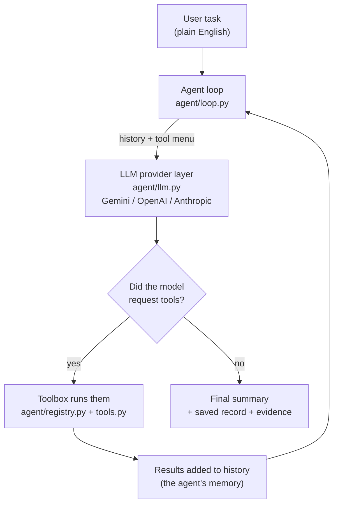
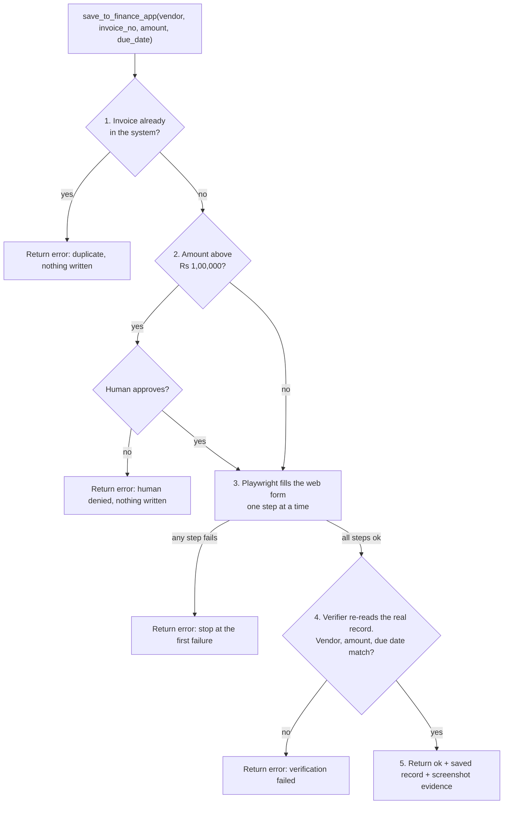
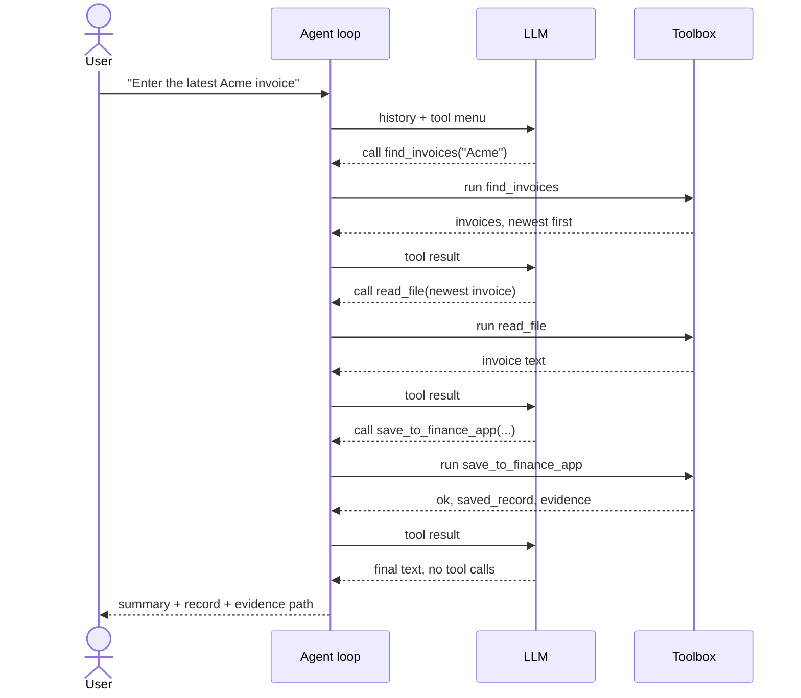
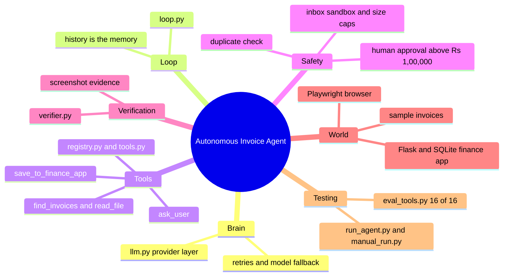

# Autonomous AI Task Worker (Invoice Entry)

An AI worker that takes a plain-English request, works out the steps itself, uses tools to do the job
on a (simulated) company system, **proves the result by reading the real data back**, and asks a human
before risky actions.

> Example: *"Find the latest invoice from Acme Corp and enter it into the finance system. Tell me when it is done."*

## Workflow at a glance



**Goal → Understand → Plan → Execute → Observe → Adapt → Verify → Complete.**
The loop stops after at most 15 rounds. The model chooses each next step. The code enforces the rules (approval, duplicate check, verification), so the model cannot skip them.

## Inside the write tool: `save_to_finance_app`



## One example run (sequence)



## Project mind map



## Repository layout

```text
ai-task-worker/
├── agent/
│   ├── loop.py          # the agent loop: ask model -> run tools -> observe -> repeat
│   ├── llm.py           # one interface over Gemini / OpenAI / Anthropic (+ retries, fallback)
│   ├── registry.py      # tool menu (TOOL_SCHEMAS) and Toolbox.run dispatcher
│   ├── tools.py         # find_invoices, list_files, read_file, ask_user, save_to_finance_app
│   ├── browser.py       # Playwright wrapper (open, fill, click, screenshot)
│   └── verifier.py      # independent check against the finance system's real records
├── finance_app/
│   └── app.py           # mock finance system: Flask + SQLite on localhost:5000
├── inbox/               # sample invoices (acme_inv_101, acme_inv_102, globex_inv_550)
├── scripts/
│   ├── run_agent.py     # run the real agent with a task
│   ├── manual_run.py    # no-AI baseline with hard-coded steps
│   └── eval_tools.py    # 16 deterministic checks, no model calls
├── notes/               # learning notes
├── requirements.txt
├── env.example          # blank template; copy to .env and add one key
└── README.md
```

## What it does (one real run, recorded before the large-inbox tools below were added)

The agent decided on its own to: list the inbox -> read both Acme invoices -> compare invoice dates ->
pick INV-102 -> save it through the finance web form -> receive a verified record -> report.

```
[step 0] list_files({'pattern': '*acme*'})            -> acme_inv_101.txt, acme_inv_102.txt
[step 2] read_file(acme_inv_101.txt), read_file(acme_inv_102.txt)    (two tools in one turn)
[step 3] save_to_finance_app(Acme Corp, INV-102, 48200, 2026-10-15)
         -> ok: "Saved and verified against the finance system."  evidence: evidence/INV-102.png
FINAL: Latest invoice INV-102 entered and verified (Record ID 1).
```

## Key design decisions

1. **The model decides each step; the code enforces the rules.** Planning is left to the model, but approval,
   duplicate prevention and verification live inside the tool, so the model cannot skip them.
2. **Independent verification.** `verify_invoice` reads the finance system's saved records and compares vendor,
   amount and due date. A tool only returns `ok: True` if this passes. The agent never marks itself done.
3. **Errors are data, not crashes.** Tools return `{"ok": False, "error": ...}` so the model can read the failure and adapt.
4. **No silent browser failures.** Every browser step's result is checked; a failed fill/click returns an error instead of a false success.
5. **Idempotency.** Re-running the same task cannot create a duplicate invoice.
6. **Provider layer.** The loop talks to one small interface (`add_user`, `generate`, `add_tool_results`), so
   the model is swappable. Added after Gemini's free tier returned 503 / daily-quota errors.
7. **Sandboxed file access.** `read_file` refuses paths that escape `inbox/`.
9. **Built for large inboxes.** The model never receives the whole inbox: `list_files` shows at most 50 names plus the total,
   `read_file` is capped at 4,000 characters, and `find_invoices(vendor)` searches *all* files in code and returns only the
   newest few summaries. On a generated 600-invoice inbox it returns the correct newest Acme invoice in about 12 ms
   in a ~500-character reply, instead of needing ~90 `read_file` calls.
8. **Reliability for slow/limited APIs.** Per-call timeout, short retries on temporary overload, immediate
   switch to a fallback model when a daily quota is used up (`GEMINI_FALLBACK_MODELS`; observed working in the duplicate run above).

## Setup and run (Windows PowerShell; macOS/Linux similar)

```
pip install -r requirements.txt
python -m playwright install chromium
copy env.example .env        # then edit .env and add ONE provider's key (never commit .env)
```

`.env` example:
```
LLM_PROVIDER=gemini
GEMINI_API_KEY=your-key
GEMINI_MODEL=gemini-3.7-flash
GEMINI_FALLBACK_MODELS=gemini-3.6-flash,gemini-3.5-flash
```
(or `LLM_PROVIDER=openai` with `OPENAI_API_KEY` / `OPENAI_MODEL`, or `anthropic` with `ANTHROPIC_API_KEY`)

Run (two terminals, from the project folder):
```
python finance_app/app.py            # terminal 1: mock finance system on http://localhost:5000
python scripts/run_agent.py          # terminal 2: runs the default Acme task
python scripts/run_agent.py "Enter the latest invoice from Globex Ltd into the finance system."
```
Reset data between runs: stop the app, delete `finance_app/finance.db`, restart.
`python scripts/manual_run.py` is a hard-coded, no-AI baseline that proves the environment works.

## Demo scenarios (all three run against the real code)

| Scenario | Command | Observed behaviour |
|---|---|---|
| Happy path | default task | Picks INV-102, saves via browser form, verified |
| High value (Rs 1,25,000) | Globex task | Pauses for approval. `no` -> aborted, nothing saved. `yes` -> saved and verified |
| Duplicate | run the default task again | Tool refuses: "already exists"; agent reports it instead of claiming success |

**High value, approval denied** (nothing is written; the agent reports this honestly):
```
APPROVAL REQUIRED: High-value invoice detected.   Vendor: Globex Ltd | Amount: Rs 125,000.00
Approve saving this invoice to the internal system? (yes/no): no
[step 4] save_to_finance_app(Globex Ltd, INV-550, 125000, 2026-10-20)
         -> {'ok': False, 'error': 'Action aborted: Human denied the transaction.'}
FINAL: ... the action was aborted because the transaction was denied during human approval.
```

**High value, approval granted:**
```
Approve saving this invoice to the internal system? (yes/no): yes
[step 2] save_to_finance_app(...) -> ok: "Saved and verified against the finance system."
         saved_record: {id: 2, invoice_no: INV-550, amount: 125000.0, due_date: 2026-10-20}
         evidence: evidence/INV-550.png
```

**Duplicate** (also shows the automatic model fallback when a daily quota ran out):
```
(gemini-3.7-flash: daily quota used up or unavailable)
[switching to fallback model: gemini-3.6-flash]
[step 2] save_to_finance_app(Acme Corp, INV-102, ...) -> {'ok': False,
         'error': 'Invoice INV-102 already exists in the finance system; not entering a duplicate.'}
FINAL: ... The system confirmed that invoice INV-102 is already recorded in the finance app.
```

## Evaluation (no model calls, so it runs free and repeatably)

`python scripts/eval_tools.py` starts a throw-away finance app with a temporary database, runs the scenarios below
against the real tools and prints a table. Stop your own finance app first (it uses port 5000).

| Scenario | Expected | Result |
|---|---|---|
| 600-file inbox: find newest Acme invoice | correct invoice, small reply | PASS |
| 600-file inbox: `list_files` capped | <= 50 names, reports total | PASS |
| 500 KB file read | truncated to ~4000 chars | PASS |
| Agent asks the human a question | answer returned to the agent | PASS |
| Normal invoice (Acme, Rs 48,200) | saved + verified | PASS |
| Same invoice entered twice | refused, still 1 record | PASS |
| System holds wrong amount / wrong due date | verifier catches it | PASS |
| Invoice never saved | verifier catches it | PASS |
| High value, human says NO | aborted, nothing written | PASS |
| High value, human says YES | saved + verified | PASS |
| Path escape (`../finance_app/app.py`) | blocked | PASS |
| Model calls a nonexistent tool / omits an argument | clean error, no crash | PASS |
| Web form changed (field renamed) | clear error, nothing saved | PASS |
| Finance system down | clear error, no false success | PASS |

16/16 pass. This eval also found a real bug while I was building it: an early version of the save tool built
its list of browser steps eagerly, so a failed "fill vendor" step still submitted the form (saving a record with an
empty vendor) before reporting the error. Steps now run one at a time and stop at the first failure.

## Models, services and libraries used

- LLMs (pluggable): Google Gemini (default, free tier), OpenAI, Anthropic Claude via their official Python SDKs.
- Playwright (Chromium) for browser automation; Flask + SQLite for the mock finance system; Python 3.13.
- All data is fictional. No real credentials or third-party systems are used.
- AI coding assistance (Claude) was used while building; I can explain and modify every part.

## Assumptions

- "Latest" means latest *invoice date*, not due date or file name.
- Amount threshold for human approval is Rs 1,00,000.
- The finance form has fixed field IDs (`#vendor`, `#invoice_no`, `#amount`, `#due_date`, `#save`).

## Known limitations (honest)

- One workflow (invoice entry). The tool layer is general, but only one write-tool and one mock system exist.
- `find_invoices` assumes plain-text invoices with `Vendor:` / `Invoice Date:` (ISO dates) lines and scans the folder on each call.
  It is fast for thousands of files (tested: 600) but would need an index/database for very large inboxes, and PDF/scanned invoices would need a parser/OCR.
- Large inboxes were tested at the tool level (deterministic eval), not with long live-model runs, because free-tier model quota is small.
- Choosing the *latest* invoice is the model's judgment; only the saved data is independently verified, not that choice.
- Prompt injection inside invoice text is only partly mitigated (sandboxed files, code-enforced approval, verified output); no content filtering.
- Approval is a terminal prompt (not an async approval queue).
- Each save launches a new browser; selectors are hard-coded, so UI changes fail safely (clear error) but are not self-repaired.
- Free-tier model quotas are small (about 20 requests/day/model), so repeated runs need fallback models or a paid key.
- The automated eval covers the tool layer only (deterministic). End-to-end model behaviour was checked by hand on three scenarios (happy path, approval yes/no, duplicate), not by an automated multi-run benchmark.

## What I would build next

1. End-to-end eval over the live model: many task phrasings with expected end states and a pass-rate table.
2. More traps through the agent: flaky form, conflicting invoices, injected instructions inside an invoice.
3. A generic browser toolset (open/read/fill/click) so new systems are added by config, not code.
4. Persistent company memory (vendor formats, past outcomes) and an audit log / HTML trace of every run.
5. Async approvals (Slack/email) and role-based limits.
6. A searchable index (SQLite/full-text) and PDF/OCR parsing for very large or non-text inboxes.
